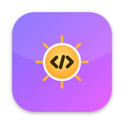
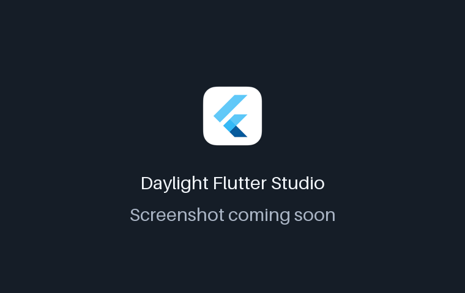
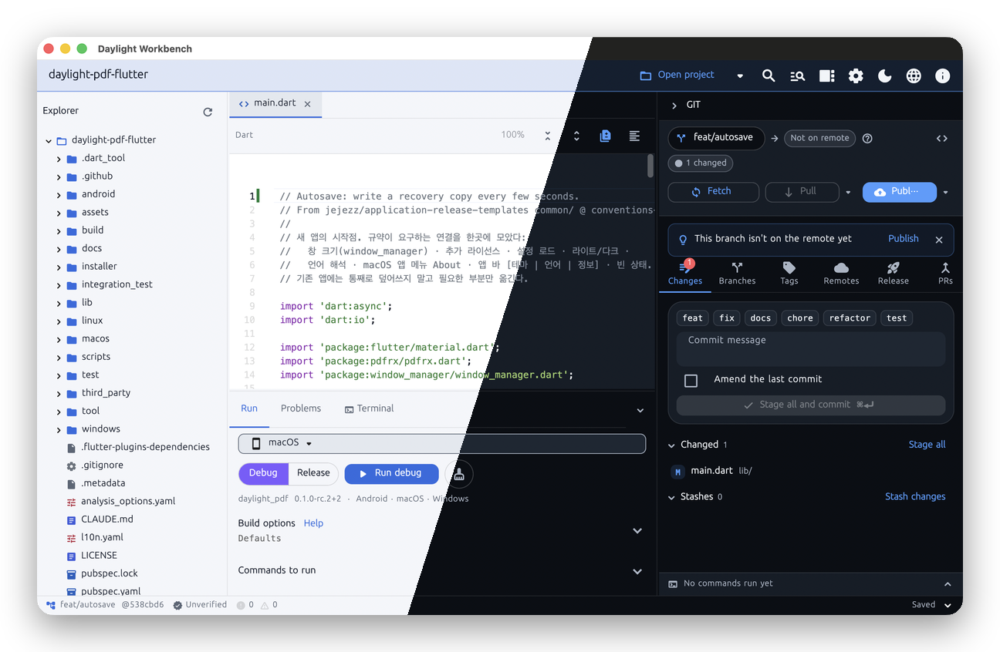
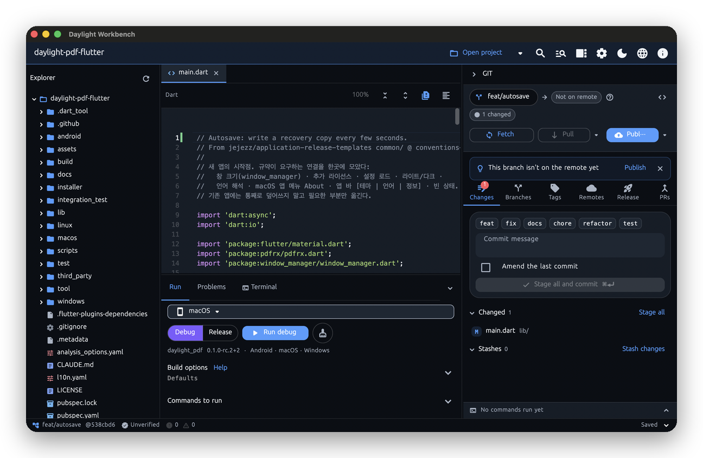

<!-- From jejezz/application-release-templates common/tool/readme @ conventions-v1.
     tool/readme/init_readme.py가 만든 파일입니다 — conventions/readme-guide.md 참고.
     {{TODO: …}}를 모두 채우십시오. 하나라도 남아 있으면 tool/readme/check_readme.py가 실패합니다. -->

<p align="center">
  
</p>

<h1 align="center">Daylight Workbench</h1>

<p align="center">
  <b>Claude Code로 Flutter 앱을 만드는</b> 사람을 위한 한 창 작업대 — 프로젝트 트리, 편집기, 빌드·설치, PR·병합·릴리스를 한곳에 묶어 작업 → 로컬 검증 → 병합 → 릴리스 순서를 건너뛸 수 없게 합니다.
</p>

<p align="center">
  <a href="https://github.com/jejezz/daylight-workbench/releases/latest"></a>
  <a href="https://github.com/jejezz/daylight-workbench/releases"></a>
  
  
  <a href="LICENSE"></a>
</p>

<p align="center">
  <a href="README.md">English</a> · <b>한국어</b>
</p>

<p align="center">
  
</p>

## 기능

- **프로젝트 트리 + 간단 편집기** — 구문 강조, Dart 괄호 접기, Dart 정렬(Ctrl+Alt+L), Markdown 보기, HEAD 대비 변경 막대, `dart analyze` 문제 표시
- **Run 패널** — 기기와 Debug/Release를 고르고 빌드·설치. 성공하면 그 커밋의 검증 기록을 남깁니다
- **병합 관문이 있는 Git 패널** — 상태, 가져오기/받기/올리기, PR 만들기·병합. 기본은 검증된 커밋만 병합합니다
- **라이트·다크, 한국어·English** — 시스템 설정을 따르거나 툴바에서 고를 수 있습니다

<p align="center">
  
  
</p>

## 설치

[**Releases**](https://github.com/jejezz/daylight-workbench/releases/latest)에서 받습니다.

| OS | 파일 |
|---|---|
| macOS 12.0 이상 | `DaylightWorkbench-<버전>-macos-universal.dmg` — 열어서 앱을 Applications 폴더로 끌어다 놓으세요 |
| Windows 10/11 (x64) | `DaylightWorkbench-<버전>-windows-x64-setup.exe` |

**Windows:** 설치 프로그램에 아직 코드 서명이 없어서 SmartScreen이 "Windows의 PC 보호" 창을 띄웁니다. **추가 정보 → 실행**을 누르세요.

## 동작 방식

Run·Git 패널은 Flutty Dock과 Branch Dock의 코드를 가져와 씁니다. 기기 빌드가 성공하면 커밋에 묶인 검증 기록(`<git-common-dir>/dock-verify/<sha>.json`)을 남기고, 병합 관문이 PR 병합 전에 이 기록을 확인합니다.

## 개발

```bash
flutter pub get
flutter run -d macos
```

Flutter SDK, `git`, GitHub CLI(`gh`)가 PATH에 있어야 합니다. 계획과 현재 상태는 [PLAN.md](PLAN.md)에 있습니다.

릴리스: `scripts/bump-version.sh patch` → 병합 → `vX.Y.Z` 태그. CI가 모든 플랫폼을 빌드해서 올립니다. 규칙: [application-release-templates/conventions](https://github.com/jejezz/application-release-templates/tree/main/conventions).

## 크레딧

- 글꼴: [서울남산체](https://www.seoul.go.kr/seoul/font.do) (서울특별시)
- 아이콘: [Icons8](https://icons8.com)

## 라이선스

[MIT](LICENSE) © 2026 Jongyun Ahn
